<!-- Generated by scripts/build.py. Edit the copy and layout there, then run it; changes made here are overwritten. -->

 
 

I compete in programming contests, build browser extensions and full-stack products, and care how the result looks: I was a poster artist before I was a programmer.

 
 

 
 
<a href="https://leetcode.com/u/AayushBadoni2005/"></a> 

 
<a href="https://github.com/AayushBadoni18/Forex-Hover"></a> 
<a href="https://github.com/AayushBadoni18/AccessBridge-AI"></a> 

 
 
 
 
 

 
 

 
 

 

